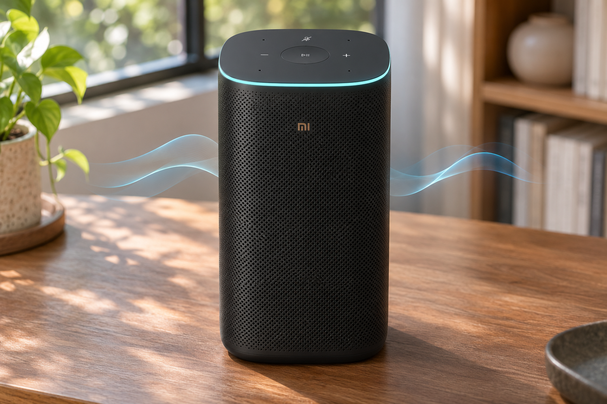
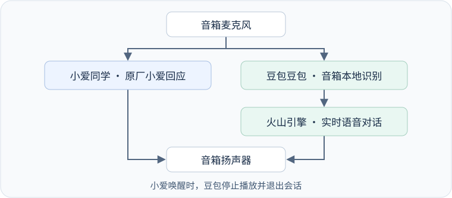

# xiaoai-voice

xiaoai-voice 为小爱音箱增加独立的豆包语音入口。喊 **「豆包豆包」** 开始实时语音对话，喊 **「小爱同学」** 使用原厂助手。当前 Windows 部署流程面向 **小爱音箱 Pro（LX06），固件 1.94.13**。默认角色是英语陪练。

## 让 Agent 带你安装

把项目下载或复制到 Windows 电脑上，在有权访问本机文件和终端的 Agent 中**打开整个项目文件夹**。然后发一句话：

> 请先读这个项目的 README 和 AGENTS.md，带我一步步给音箱装上豆包。我不懂代码，每次只告诉我现在需要做什么。

Agent 会先问你音箱的型号、固件版本，以及音箱是否在身边。需要登录网页、接线或对音箱说话时，它会告诉你怎么做，等你确认再继续。你可以只提供当前步骤的结果。

## 工作原理

喊「小爱同学」，音箱交给原厂小爱处理。喊「豆包豆包」，音箱先在本地识别唤醒词，唤醒成功后才把会话中的声音发送给火山引擎，并播出豆包返回的语音。和豆包聊天时再喊「小爱同学」，程序会停止豆包并让小爱接管。

Windows 电脑负责安装。装好并启动后，两个助手都可以直接在音箱上使用，电脑可以关机。

## 前期准备

| 准备项 | 要求 |
| --- | --- |
| 音箱 | 核对机身型号为 **LX06**，在米家 App 确认固件版本为 **1.94.13**。 |
| 电源和线材 | 原厂 LX06 准备原装电源和一根能传数据的 **Micro-USB** 线。Agent 会按音箱版本指引你准备匹配的补丁固件，并在刷写前带你核对备份。 |
| 电脑和网络 | Windows 电脑与音箱连同一个局域网。Agent 会先检查电脑上的安装工具，以及项目里有没有已编好的程序。 |
| 语音服务 | 准备你自己的火山引擎账号，开通豆包实时语音 **O2**。人在音箱旁边之前就可以先办好。 |

### 先开通豆包语音服务

1. 打开火山引擎，注册或登录自己的账号，完成实名认证。 [火山引擎官网](https://www.volcengine.com/)
2. 在火山引擎控制台搜索「豆包语音」，开通**端到端实时语音大模型**，确认页面支持 **O2**。开通前查看页面上的用量和计费说明。控制台只显示其他版本时，把服务名称告诉 Agent，由它帮你核对。 [开通指南](docs/火山引擎开通.md)
3. 在同一个语音控制台创建 **API Key**，选择刚开通服务的项目或应用。这是音箱调用语音服务的密钥，自己保存即可。聊天里只告诉 Agent「已经创建」，安装时再按提示在本机终端输入，屏幕不会显示输入的内容。

## 接入步骤

1. **确认设备。** 把机身型号和米家 App 显示的固件版本告诉 Agent。Agent 会判断能否用本项目的安装流程。
2. **准备好音箱。** 如果音箱还是原厂系统，Agent 会帮你核对对应型号的补丁固件，说明备份和刷写步骤。写入固件前会请你确认。
3. **检查再安装。** Agent 会检查音箱能否录放音，请你喊一声「小爱同学」验证切换信号，然后带你输入语音密钥、安装并启动豆包。
4. **试用两个助手。** 先用「小爱同学」执行一条家电或音量指令，再喊「豆包豆包」聊两轮。最后在豆包说话时喊「小爱同学」，确认豆包停播、小爱接管。Agent 会根据结果继续排查。

Agent 所需的详细操作在 [LX06 Windows 安装指南](docs/LX06-Windows.md)。

## 理论上支持哪些音箱

双唤醒移植要求设备能运行自定义程序、和原厂助手共享录放音、检测原厂唤醒事件，并有足够内存运行本地唤醒模型。判断兼容性时，以机身型号、硬件批次和固件版本为准。

| 型号 | 已知状态 |
| --- | --- |
| **小爱音箱 Pro（LX06，1.94.13）** | 本项目的 Windows 适配目标。已完成 ARM 构建和模拟启动测试，真机录放音、唤醒和切换待验收。Open-XiaoAI 的本地唤醒示例在带 DTS 的 **256 MB** LX06 上验证过，部分 **128 MB** 批次运行该示例时内存不足。 [上游唤醒示例](https://github.com/idootop/open-xiaoai/tree/main/examples/kws) |
| **小米智能音箱 Pro（OH2P，1.62.2）** | 上游已有小爱和豆包双唤醒的实机记录，使用 OH2P 对应流程。 [OH2P 搭建指南](docs/搭建指南.md) |
| **其他小爱音箱** | **LX01、L09A** 有社区固件适配记录，可以据此评估音频接口和内存。**OH2、S12、L15A、L05B、L05C、LX04** 等有 MiGPT 的文本转发方案。以上型号的 xiaoai-voice 双唤醒仍需单独移植和验证。 [社区固件](https://github.com/duhow/xiaoai-patch#compatibility) · [MiGPT 型号表](https://github.com/idootop/mi-gpt/blob/main/docs/compatibility.md) |
| **天猫精灵、小度** | 本项目暂无适配型号。有原厂技能接口的设备可通过相应平台接入自己的后端，语音入口仍由原厂助手处理。 [AliGenie 技能平台](https://www.aligenie.com/skills) · [DuerOS 开放平台](https://developer.dueros.baidu.com/open) |

## 致谢

- 感谢 **Open-XiaoAI** 提供 LX06 的固件适配资料、共享音频接口和自定义唤醒示例，为本项目的设备适配提供了基础。 [idootop/open-xiaoai](https://github.com/idootop/open-xiaoai)
- 感谢 **xiaoai-plus** 和 **xiaoai-doubao** 提供实时语音、唤醒处理和对话逻辑的实现。 [kslr/xiaoai-plus](https://github.com/kslr/xiaoai-plus) · [rolazd/xiaoai-doubao](https://github.com/rolazd/xiaoai-doubao)

## 许可

项目使用 [MIT 许可证](LICENSE)。上游项目和依赖的许可证见 [第三方来源与许可](THIRD_PARTY.md)。
